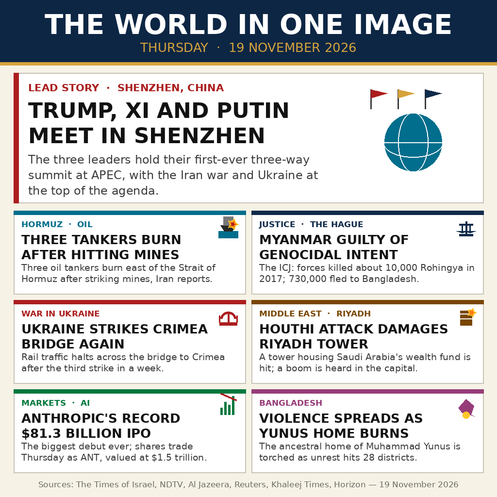

# 19 November 2026 — World News in One Image

[](https://make.fun/bounty/news-image-20261119?utm_source=github&utm_medium=readme&utm_campaign=news-image-20261119)
[](https://make.fun/bounty/news-image-20261119/leaderboard?utm_source=github&utm_medium=readme&utm_campaign=news-image-20261119)
[](https://make.fun/bounty/news-image-20261119?utm_source=github&utm_medium=readme&utm_campaign=news-image-20261119)

An entry for make.fun's bounty
[news-image-20261119](https://make.fun/bounty/news-image-20261119):
a program that writes one 1024×1024 image summing up the world's news of
Thursday 19 November 2026. The image is a newspaper front page: a masthead,
one lead story, and six more stories, each with a headline and a one-line
summary — so the picture itself tells the day's news, with no news feed
needed to read it.



## The stories in the image

1. **Lead — Trump, Xi and Putin meet in Shenzhen.** The three leaders
   hold their first-ever three-way summit at APEC, with the Iran war and
   Ukraine at the top of the agenda.
2. **Hormuz · Oil — Three tankers burn after hitting mines.** Three oil
   tankers burn east of the Strait of Hormuz after striking mines, Iran
   reports.
3. **Justice · The Hague — Myanmar guilty of genocidal intent.** The ICJ:
   forces killed about 10,000 Rohingya in 2017; 730,000 fled to
   Bangladesh.
4. **War in Ukraine — Ukraine strikes Crimea Bridge again.** Rail traffic
   halts across the bridge to Crimea after the third strike in a week.
5. **Middle East · Riyadh — Houthi attack damages Riyadh tower.** A tower
   housing Saudi Arabia's wealth fund is hit; a boom is heard in the
   capital.
6. **Markets · AI — Anthropic's record $81.3 billion IPO.** The biggest
   debut ever; shares trade Thursday as ANT, valued at $1.5 trillion.
7. **Bangladesh — Violence spreads as Yunus home burns.** The ancestral
   home of Muhammad Yunus is torched as unrest hits 28 districts.

Sources: The Times of Israel, NDTV, Al Jazeera, Reuters, Khaleej Times,
Horizon — all reporting on 19 November 2026.

## How to run it

```sh
mkdir -p out
MAKEFUN_OUTPUT_DIR=out python3 main.py
```

That writes `out/entry.png`: exactly 1024×1024, PNG, under 1 MiB.
Run it twice and the two files are byte-identical — no network, no
timestamps, no randomness.

## How the entry was built

`main.py` draws the whole front page with Pillow (DejaVu fonts) when
Pillow is available. The grading sandbox is a bare `python:3.13-slim`
image with the standard library only, so when Pillow is missing the
program instead copies the pre-rendered `entry.png` shipped in this
repository — the same image the drawing code produces, verified
byte-identical by running with the Pillow import blocked.
